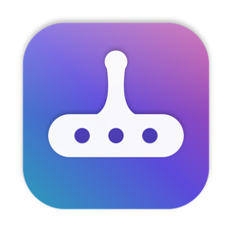
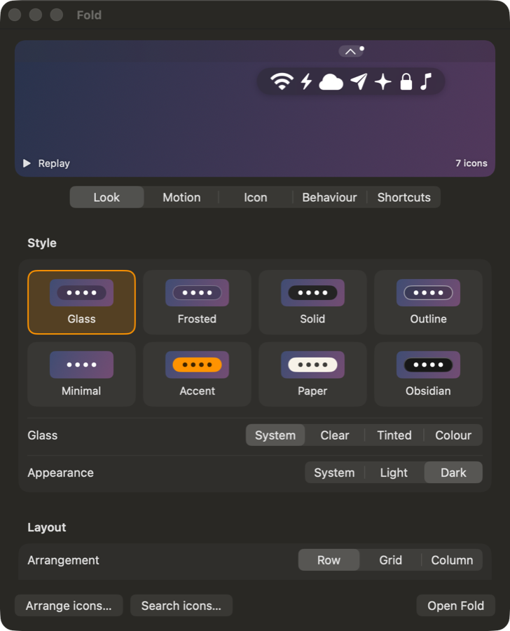

<p align="center"></p>
<h1 align="center">Fold</h1>
<p align="center">A quiet menu-bar drawer for macOS 26: one icon, and the icons you've hidden pour out underneath.</p>

A quiet menu-bar drawer for macOS 26. One icon in your menu bar; click it (or rest on it) and the icons you've hidden pour out underneath in a small Liquid Glass bar. Click any of them to open its own menu or popover.

Fold is built on [Thaw](https://github.com/thaw-app/Thaw) (itself a fork of [Ice](https://github.com/jordanbaird/Ice)) and uses its engine for hiding, revealing and arranging menu-bar items.

## Install

1. Download `Fold-x.y.z.zip` from the [latest release](https://github.com/SamDeHerdt/Fold/releases/latest) and unzip it.
2. Move **Fold.app** to Applications.
3. Fold isn't notarized, so the first time: right-click Fold.app → **Open** → **Open**.
4. In **System Settings → Privacy & Security**, allow **Fold** under **Accessibility** and **Screen & System Audio Recording**.

After that Fold updates itself: it checks this repo once a day, and you can also right-click the menu-bar icon → **Check for Updates…**. Every update is verified against Fold's signing key before it installs.

## Using it

- **Open:** click the menu-bar icon, or turn on *Open on hover* and rest on it.
- **Right-click the icon:** Open Fold, Search Icons…, Motion ▸, Look ▸, Open on Hover, Arrange Icons…, Check for Updates…, Settings… (⌘,), Quit.
- **Arrange:** choose which icons live in the drawer (Settings → Arrange icons…), or ⌘-drag icons in the menu bar.
- **Search:** find and open any menu-bar icon by name, hidden or not.
- **Keyboard:** open Fold with your shortcut, then arrows move, Return opens, Esc closes, and typing jumps to an app.
- **macOS 27** is not supported yet; that needs a port to Thaw's 3.0 engine.

### Settings

A live preview sits on top and replays every change.

<p align="center"></p>
<p align="center"><sub>The preview uses Fold's built-in sample icons; no real menu-bar items or data.</sub></p>

| Tab | What's there |
|---|---|
| Look | Glass (System / Clear / Tinted), Frosted, Solid, Outline, Minimal, Accent, Paper, Obsidian · Light / Dark / System · **Layout:** Row / Grid / Column, length or rows shown, icon size, icon spacing, position |
| Motion | Liquid (gooey pour), Bubbles, Pop, Fold, Cascade, Materialize, Glide, Fade, None — all start at the menu-bar icon; Reduce Motion makes them instant |
| Icon | 14 menu-bar icons |
| Behaviour | Open on hover and delay · when to close · open at login · attention dot · updates |
| Shortcuts | Keys to open Fold and to search icons |

## Build

Requires Xcode 26.4+ and Apple Silicon.

```sh
fold/build.sh            # → dist/Fold.app
```

## Release (maintainer)

```sh
fold/release.sh 1.1.0 "What changed"
```

Commits the version, builds, zips, signs the zip with Fold's EdDSA key (kept in the maintainer's keychain), writes `appcast.xml`, tags, pushes and publishes the GitHub release. Installed copies pick it up through Sparkle.

## Licence

GPL-3.0, as inherited from Thaw (© 2026 Toni Förster) and Ice (© 2023–2025 Jordan Baird). Their licence, credits and original README (`README.thaw.md`) are kept in this repository.
